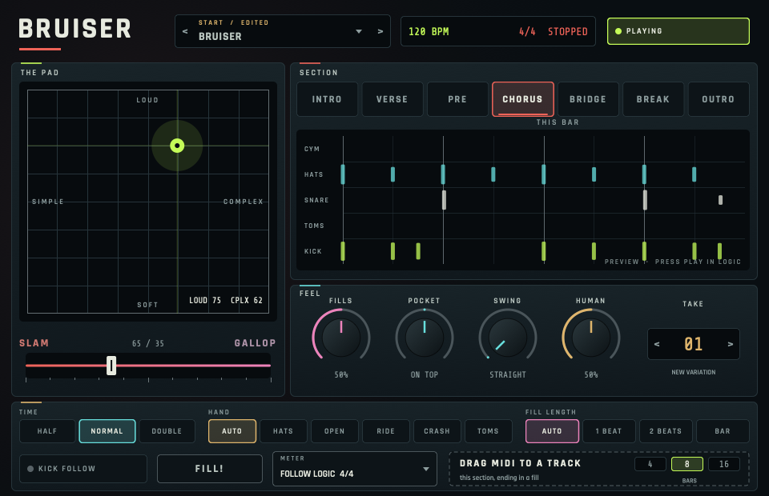
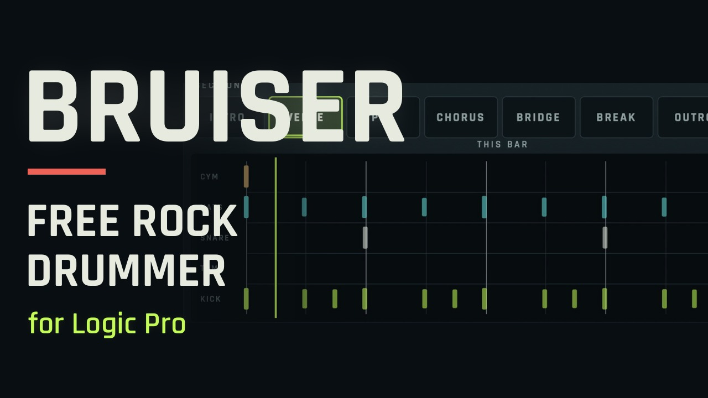

# BRUISER

A rock drummer for Logic Pro: a MIDI FX plug-in (Audio Unit) that writes drum parts live, following Logic's tempo, meter, transport and cycle.

> Made by **Rob Cawley**, a musician in Dublin, for his own records, and shared free for anyone to try.
> If you make something with it, I'd love to hear it. Share it in [Made with it](https://github.com/robcawley/bruiser/discussions/categories/made-with-it) or post it anywhere, and if you like, link back to my music:
> **[robcawley.com](https://robcawley.com)** · **[Bandcamp](https://robcawley.bandcamp.com)** · the new album **[Room Tone](https://robcawley.com/roomtone/)**.

*▶ Watch the preset showcase on YouTube.*

## What it does

- Put it in the MIDI FX slot of a drum instrument. It was made to drive [ROB KIT](https://github.com/robcawley/rob-kit) and plays Logic's standard drum note map on channel 10.
- One axis, **SLAM ↔ GALLOP**, moves the feel from heavy and behind the beat to driving and pushed.
- **Sections:** Intro, Verse, Pre, Chorus, Bridge, Break and Outro. Changes land on the next bar line with a crash, and the Section parameter can be automated to arrange a whole song.
- Automatic fills at phrase ends, plus a FILL! button.
- **Kick Follow:** copy your bass region onto the drum track and every bass note becomes a kick.
- **Odd meters:** 3/4, 5/4, 6/8, 7/8, 7/4, 9/8, 11/8, 12/8, 5/8, 13/8 and 6/4, phrased the way a drummer would play them.
- 90 factory presets in Logic's preset menu. Drag the current part out as a MIDI file.
- No loops or recorded parts: every groove is generated, and the same song position always plays the same, so cycles repeat exactly.

## Download

Get the ready-built plug-in from the **[latest release](https://github.com/robcawley/bruiser/releases/latest)** (macOS 12 or later, Apple Silicon and Intel).

1. Unzip it and move `BRUISER.component` into `~/Library/Audio/Plug-Ins/Components` (in Finder: Go → Go to Folder…, then paste that path).
2. The plug-in isn't signed with an Apple developer certificate, so macOS blocks it the first time. Open Terminal and run:

       xattr -dr com.apple.quarantine ~/Library/Audio/Plug-Ins/Components/"BRUISER.component"

3. Restart Logic. It appears under MIDI FX → Audio Units → Rob Cawley → BRUISER. Put it in the MIDI FX slot above ROB KIT (or any drum instrument that uses Logic's standard drum map).

## Build from source

Or build it yourself on a Mac with the Xcode Command Line Tools and CMake.

    git clone https://github.com/robcawley/bruiser.git
    cd bruiser
    git clone --branch 8.0.4 --depth 1 https://github.com/juce-framework/JUCE.git JUCE
    cmake -S . -B build -DCMAKE_BUILD_TYPE=Release -DJUCE_DIR="$PWD/JUCE"
    cmake --build build -j 8 --target Bruiser_AU

Copy the `.component` from `build/Bruiser_artefacts/Release/AU/` to `~/Library/Audio/Plug-Ins/Components` if the build hasn't already. In Logic it appears under MIDI FX → Audio Units → Rob Cawley.

## Sister projects

- [ROB KIT](https://github.com/robcawley/rob-kit): the drum instrument BRUISER plays.
- [NEON RIOT](https://github.com/robcawley/neon-riot): a heavy bass synthesizer.
- [THE GREAT COMPOSER](https://github.com/robcawley/the-great-composer): chords in, orchestral MIDI out.
- [UNDERTOW](https://github.com/robcawley/undertow): an ambient space effect.

## Licence

AGPL-3.0 (see `LICENSE`), the same open-source licence as the JUCE framework. Fonts: Rajdhani and Share Tech Mono, SIL Open Font Licence.
